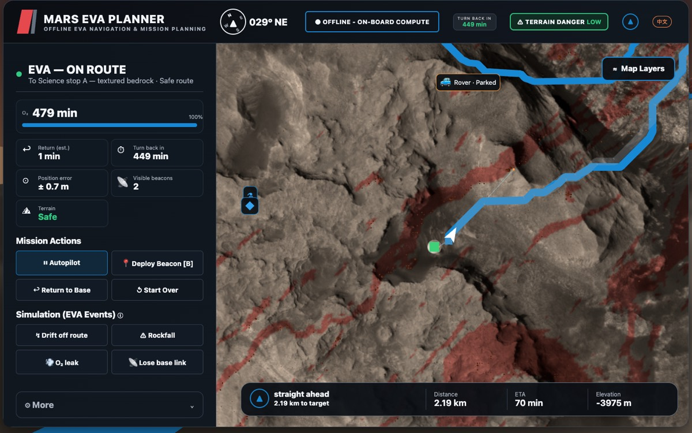
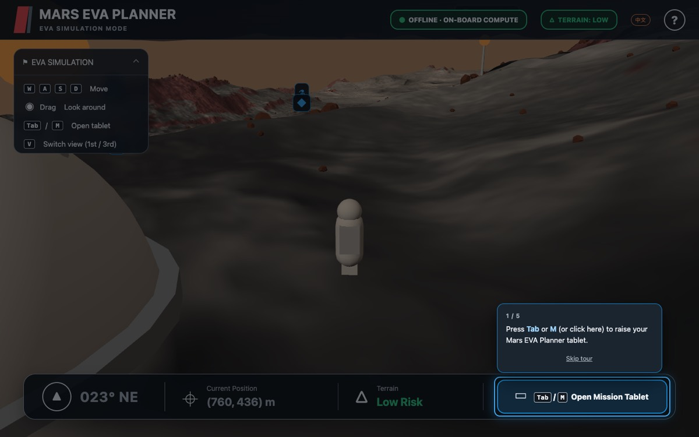
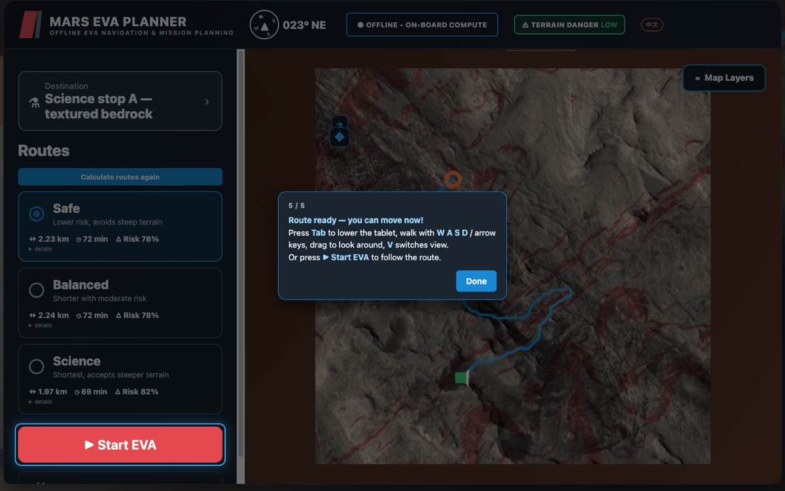
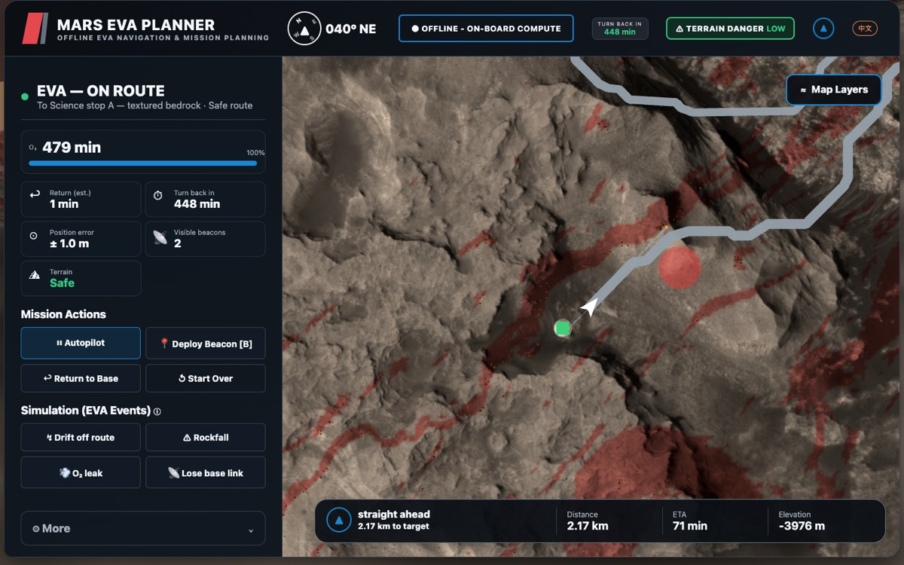
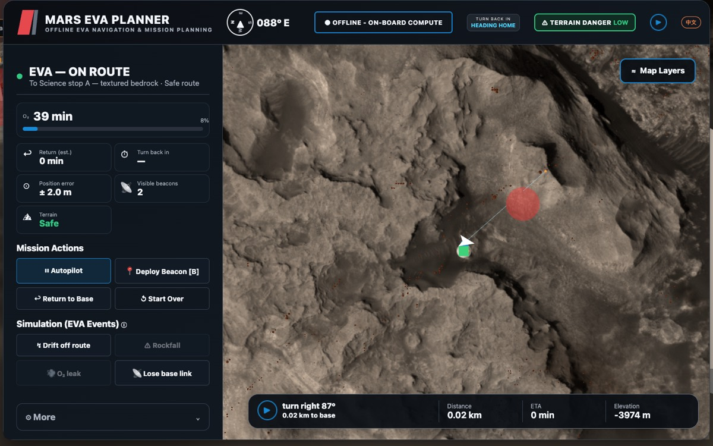
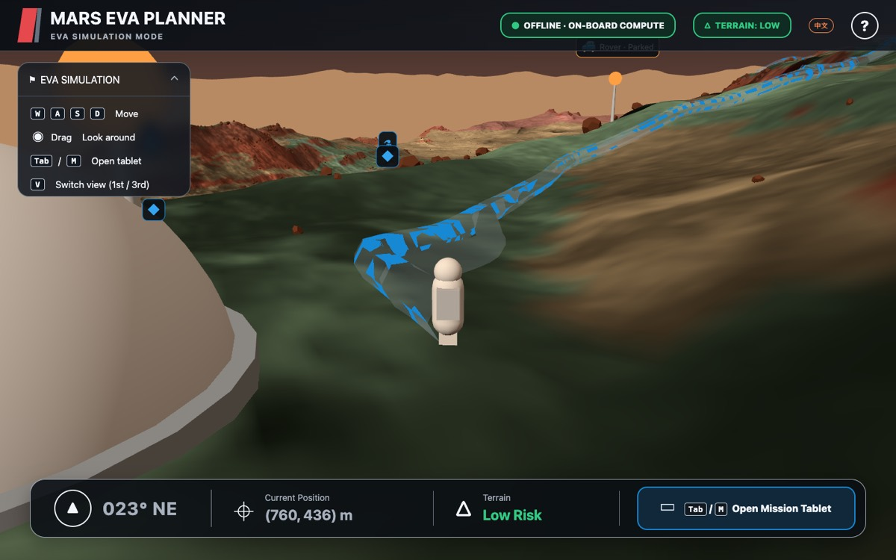
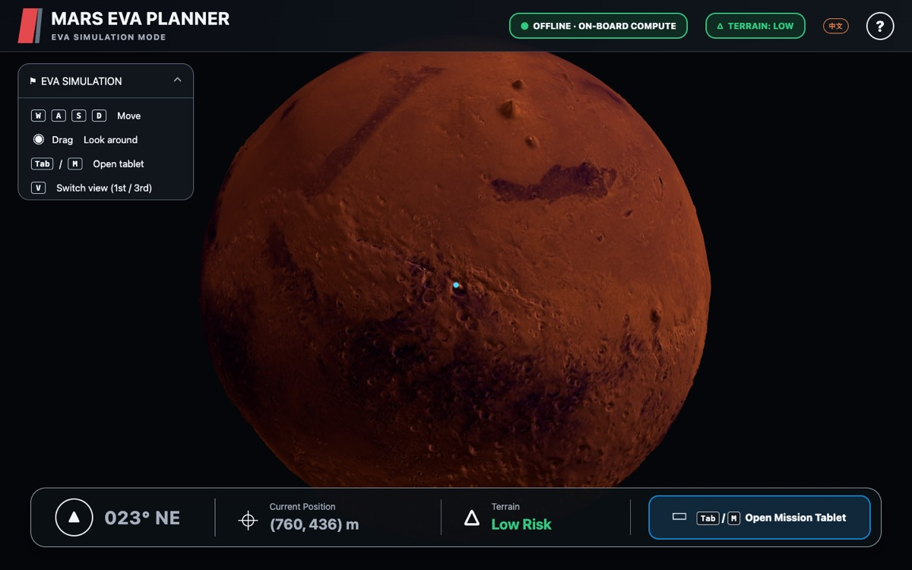

<!-- SI-assisted: first drafted by Hermes Agent (SI tool), rewritten by Claude Code (Anthropic, SI tool) from the project's code and data; reviewed by the team. -->
# Mars EVA Planner

An offline navigation tablet for astronauts walking on Mars. It plans safe routes on real NASA terrain, tracks the point of no return, and re-plans on the device when something goes wrong.

**Live demo (runs in the browser, no install):** https://bobhsu408.github.io/martian-map/

NASA Space Apps Challenge 2026 · Challenge: *Interplanetary Survival Guide: Martian Map* · Team **It Worked on Earth!!!** (YI-FAN YU, PO-TING HSU)



## Contents

- [Why](#why)
- [Screenshots](#screenshots)
- [How to use it](#how-to-use-it)
- [Features](#features)
- [How it works](#how-it-works)
- [Run it locally](#run-it-locally)
- [Project structure](#project-structure)
- [Data](#data)
- [Testing](#testing)
- [Limitations](#limitations)
- [Use of SI (AI) tools](#use-of-si-ai-tools)
- [Team and credits](#team-and-credits)

## Why

On a Mars walk, the questions are local and urgent: is the next stretch of ground safe, and is there enough oxygen to get back? A message to Earth takes 4 to 24 minutes, and there is no GPS. Mars EVA Planner answers these questions on the astronaut's own device, using a HiRISE terrain model of Mount Sharp in Gale crater.

## Screenshots

| | |
|---|---|
|  |  |
| First-time tour: raise the tablet | Three routes compared, ready to go |
|  |  |
| Rockfall: new route in under a second | Oxygen leak: the tablet sends you home |
|  |  |
| Walking the route on HiRISE terrain | Zoom out to the whole planet |

## How to use it

1. Open the demo and press **Start**. A spotlight tour guides your first plan.
2. Raise the tablet (**Tab** or **M**), pick a science stop or a custom point, and press **Calculate routes**.
3. Choose Safe, Balanced or Science, then press **▶ Start EVA**. Walk it yourself or turn on **Autopilot**.
4. Try the emergencies on the tablet: **Rockfall**, **O₂ leak**, **Drift off route**, **Lose base link**.

| Control | Action |
|---|---|
| W A S D or arrow keys | Walk and turn |
| Drag | Look around |
| Tab or M | Raise or lower the tablet |
| Esc | Lower the tablet |
| V | First or third person |
| B | Drop a UWB beacon (during an EVA, up to 4) |
| Mouse wheel / double-click on the tablet map | Zoom / reset the map |
| ? (top right) | Show the intro and replay the tour |

URL options: `?nointro` skips the intro and tour, `?site=nw` loads the second HiRISE site, `?synthetic` uses a generated test terrain, `?server` uses the optional local Rust server, and `?viewer` uses the plain JavaScript DEM viewer without the WebAssembly engine.

## Features

- Three routes per walk (safe, balanced, science) with distance, time, risk, steepest slope, closest hazard and an estimated radiation dose
- Point of no return from the remaining oxygen: a "turn back in" countdown on the tablet and a red boundary on the ground
- On-board re-planning after a rockfall, a drift off the route or an oxygen leak (return to base)
- Positioning without GPS: LoRa and UWB beacon ranging with line of sight over the terrain, multilateration, and dead reckoning; after losing the base link you can drop your own beacons
- Walkable 3D scene with a handheld tablet, minimap, and vibration and sound cues for steering
- Map layers: slope, hazards (no-go), penalty cost (safe and science), beacon coverage, point-of-no-return zone
- Map scales from the 2 m walking site to the Gale crater region, a 2D map of Mars and a 3D globe
- First-time spotlight tour, and an English / 中文 interface

## How it works

- **Cost map.** Slope (Horn's method) and roughness come from the HiRISE model at 2.02 m. Ground steeper than 25° or rougher than 0.30 m is no-go. Other cells cost more the steeper and rougher they are and the closer they are to a no-go cell (exact Euclidean distance transform).
- **Routes.** A* on an 8-connected grid, with three weightings. Walking speed follows a Tobler hiking function, slowed on rough ground.
- **Point of no return.** A Dijkstra pass from the habitat gives the time home from every cell. A cell is reachable when the time there, plus the time home, plus a 30-minute reserve, fits in the oxygen left.
- **Positioning.** Line of sight from each beacon over the terrain, weighted Gauss–Newton multilateration with three or more ranges, dead reckoning otherwise. Ranges are simulated in the demo.
- **Radiation.** Walking time × 0.7 mSv/day, the level Curiosity's RAD measured on the surface.
- **Offline.** The Rust engine is compiled to WebAssembly and runs in a Web Worker, so the site works with the network unplugged.

The full write-up is in [engDocs/SUBMISSION.md](engDocs/SUBMISSION.md), and the engine API is in [docs/API.md](docs/API.md).

## Run it locally

**Requirements**
- Node.js 20.19+ or 22.12+ (for Vite 8)
- Only to rebuild the engine: Rust 1.85+ (edition 2024), `rustup target add wasm32-unknown-unknown`, `cargo install wasm-bindgen-cli --version 0.2.130`
- Only to regenerate the map data: Python 3 with `pip install -r tools/requirements.txt` (NumPy, Pillow)

**Run the app.** The built WebAssembly engine and the processed terrain data are already in the repository.

```
cd web
npm install
npm run dev        # development server, http://localhost:5173
npm run build      # production build into web/dist
npx vite preview   # serve the build, http://localhost:4173
```

**Rebuild the engine** after changing Rust code: `./tools/build_wasm.sh` (writes to `web/src/wasm/`).

**Optional local server:** `cd engine && cargo run --release -p mars-server`, then open `http://127.0.0.1:8080/?server`.

**Deploy.** Every push to `main` builds `web/` and publishes it to GitHub Pages ([.github/workflows/pages.yml](.github/workflows/pages.yml)).

## Project structure

```
engine/                Rust workspace
  crates/core/         algorithms: terrain, cost map, A*, EVA model, planner, positioning
  crates/wasm/         WebAssembly build of the engine (runs in a Web Worker)
  crates/server/       optional local HTTP server (axum)
web/                   front end (Vite + Three.js)
  src/main.js          the app: 3D scene, tablet, EVA simulation
  src/tour.js          first-time spotlight tour
  src/i18n.js          English / Chinese toggle
  src/api.js           engine back ends (WebAssembly, server, viewer)
  public/data/         terrain and map data served with the app
data/processed/        preprocessed NASA data (DEM, orthophoto, global and regional maps)
tools/                 Python preprocessing, WebAssembly build script, browser tests
docs/                  API, data catalog, AI usage log (Chinese), dev log, Chinese README
engDocs/               submission text and SI usage log (English)
```

## Data

All data is NASA data, bundled with the app so it works offline.

| Data | Used for |
|---|---|
| [HiRISE DTM DTEEC_001488_1750_001752_1750_U02](https://www.uahirise.org/dtm/dtm.php?ID=PSP_001488_1750) and orthophoto | Main walking site (Mount Sharp foothills), resampled to 2.02 m |
| [HiRISE DTM DTEEC_019698_1750_019988_1750_U01](https://www.uahirise.org/dtm/dtm.php?ID=ESP_019698_1750) | Second site, lower NW Mount Sharp (`?site=nw`) |
| [MGS MOLA MEGDR](https://pds-geosciences.wustl.edu/missions/mgs/megdr.html) | Mars globe |
| [MGS MOLA 463 m global DEM (USGS Astrogeology mosaic)](https://astrogeology.usgs.gov/search/map/mars_mgs_mola_dem_463m) | Gale crater region and far terrain |
| [Viking MDIM colour mosaic](https://www.mars.asu.edu/data/mdim_color/) | Global base map |
| [MGS MOC Wide Angle Atlas](https://www.mars.asu.edu/data/moc_256/) | Gale crater regional image |
| Curiosity RAD surface dose rate ([Hassler et al. 2014](https://doi.org/10.1126/science.1244797)) | Radiation dose estimate |

To regenerate the processed data from the raw NASA files, see [docs/README.zh.md](docs/README.zh.md) (Chinese) and [docs/HIRISE_PREPROCESS_PLAN.md](docs/HIRISE_PREPROCESS_PLAN.md). Dataset details are in [docs/DATA_CATALOG.md](docs/DATA_CATALOG.md).

## Testing

```
cd engine && cargo test                                                # 45 Rust tests
node tools/e2e_tablet.mjs <out-dir> "http://localhost:4173/?nointro"   # plan, EVA, rockfall
node tools/e2e_tour.mjs <out-dir> http://localhost:4173/               # spotlight tour (add "zh" for Chinese)
node tools/e2e_shots.mjs <out-dir> "http://localhost:4173/?nointro"    # full walkthrough with screenshots
```

The browser tests drive headless Google Chrome (macOS path in the scripts) and save screenshots to `<out-dir>`.

## Limitations

- The walkable area is a 2 km × 2 km crop of the HiRISE model.
- Science stops are candidates picked from the terrain, not confirmed boxwork outcrops.
- Beacon ranges are simulated.
- The radiation dose is an average-rate estimate, not a radiation map.

## Use of SI (AI) tools

- **Claude Code (Anthropic)** wrote most of the code: the Rust engine, the WebAssembly build, the Three.js interface, the onboarding tour, the tests and the deployment. It also drafted documentation and the submission text.
- **Codex (OpenAI)** explained the tech stack, researched Mars map data, wrote the Python preprocessing tools, built the zoomable 2D map, and rebuilt the tablet interface from our reference designs.
- **Antigravity AI** proposed the tablet redesign plan from our reference images. Codex finished the work.
- **Hermes Agent** drafted the first README.
- **ChatGPT, Google Translate and Grammarly** helped translate and polish our English text.
- The team chose the problem, the site and the offline-tablet concept, designed the experience, chose and preprocessed the NASA data, wrote `hazard_mask` by hand, and tested and approved every change.
- Every file written or assisted by SI says so on its first line (`SI-generated` or `SI-assisted`). We used no SI-generated images, video or audio. The screenshots are from the app itself.
- Step-by-step log: [engDocs/SI_usage.md](engDocs/SI_usage.md) (English) and [docs/AI_USAGE.md](docs/AI_USAGE.md) (Chinese).

## Team and credits

**It Worked on Earth!!!**: YI-FAN YU, PO-TING HSU

- HiRISE data: NASA/JPL/University of Arizona
- MOLA data: NASA/GSFC, MGS MOLA Science Team; 463 m mosaic by USGS Astrogeology
- Viking and MOC mosaics: NASA, served by Arizona State University
- Open-source libraries: Three.js, Vite, Rust, wasm-bindgen, axum, Tokio, Rayon, Serde, pathfinding, proptest, NumPy, Pillow

More: [development log with screenshots](docs/DEVLOG.md) (Chinese).
