<!-- SI-generated: written by Claude Code (Anthropic, SI tool) from the git history, the AI usage log and fresh test runs; screenshots are from the app itself. -->
# 開發小日誌：Martian Map（NASA Space Apps 2026）

> 隊伍：It Worked on Earth!!!　挑戰：Interplanetary Survival Guide: Martian Map
> 線上 Demo：<https://bobhsu408.github.io/martian-map/>　原始碼：<https://github.com/bobhsu408/martian-map>
> 整理時間：2026-11-15 20:00

**一句話**：給在火星上走路的太空人用的離線導航平板。它用 NASA 的 Mount Sharp 地形資料規劃三條安全步行路線，隨時顯示「不歸點」（剩下的氧氣只夠走回基地的那一刻），遇到落石或氧氣外洩時，直接在裝置上重新規劃，完全不用連回地球。

---

## 1. 兩天的時間軸

| 時間 | 誰 | 做了什麼 |
|---|---|---|
| 11/14 17:00 | 博庭 + Claude | 搭好 Rust 引擎骨架：網格、合成地形、坡度、粗糙度、距離轉換，並寫好 API 規格與開發計畫 |
| 11/14 17:40 | **博庭親手寫** | `hazard_mask`：判斷哪些格子是禁區 |
| 11/14 17:50–18:30 | 博庭 + Claude | 成本地圖、A*／Dijkstra 尋路、EVA 時間與氧氣模型、三路線比較、不歸點、重新規劃；Three.js 前端；信標定位；把引擎編成 WebAssembly 跑在瀏覽器裡 |
| 11/14 21:20 | 博庭 + Claude | 換成真的 NASA 資料：HiRISE 地形（Mount Sharp）、MOLA 全球與 Gale 區域 |
| 11/14 22:20–23:50 | Yi-Fan + Codex | 資料前處理工具（mod1）、Gale 的 MOC 區域圖（mod2）、連續縮放的 2D 地圖（mod3） |
| 11/15 01:00 | 博庭 + Claude | 改成「太空人手持平板」的探索視角 |
| 11/15 07:00 | 博庭 + Claude | 中英切換、抵達後可自由行走、與基地斷線後自己布設信標、看得見的不歸點 |
| 11/15 07:20 | 博庭 + Claude | 英文提交內容初稿 |
| 11/15 12:00 | Yi-Fan | SI 使用紀錄英譯 |
| 11/15 16:30–18:15 | Yi-Fan + Codex | 依參考設計圖重做整個平板 UI、3D 場景標記、圖層修正 |
| 11/15 18:45 | Claude | 整合Yi-Fan的新 UI 進 main，修正測試腳本並實測 |
| 11/15 19:10 | 博庭定流程 + Claude | **新手高亮導覽** |
| 11/15 19:20 | Claude | repo 公開、GitHub Pages 自動部署、填入提交網址 |
| 11/15 20:00 | Claude | 全專案檢查、補 SI 標記、起草 SI 段落、這份日誌 |

全部共 43 個 commit。規模大約是 Rust 7,300 行（引擎與測試）、JavaScript 2,650 行、CSS 550 行、Python 1,100 行（資料前處理）。

---

## 2. 使用者看到的流程（附截圖）

### 2.1 一進來：新手導覽
畫面變暗，只亮出下一步要按的地方。使用者真的照做了才會前進。

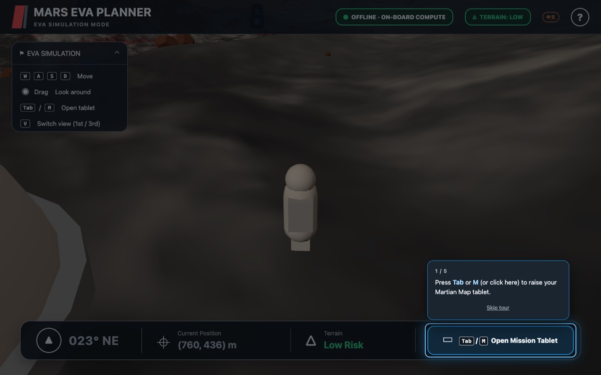
*第 1 步：按 Tab／M 舉起平板。*

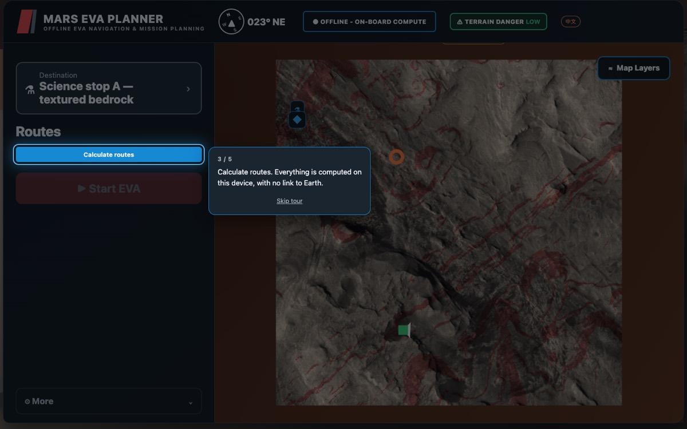
*第 2、3 步：選好目的地後，亮框移到「Calculate routes」。*

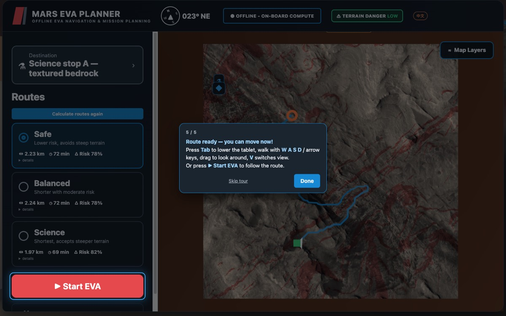
*第 4、5 步：比較三條路線，最後告訴使用者「路線已就緒，現在可以移動了」。*

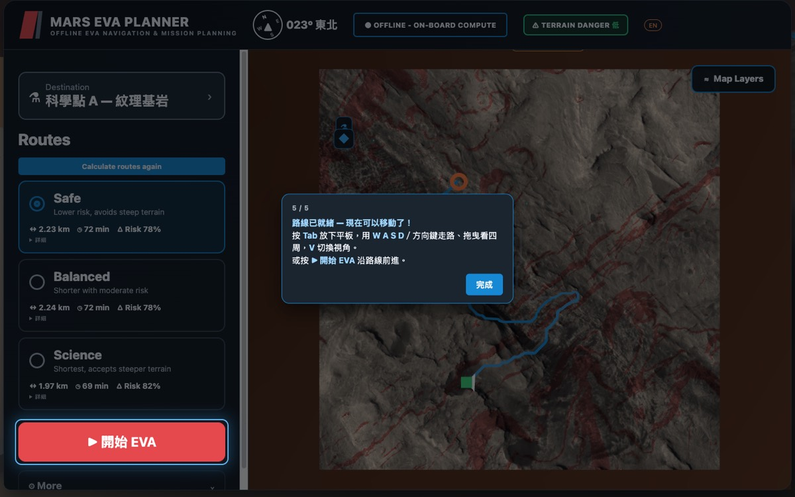
*導覽會跟著中文／EN 切換。*

### 2.2 在火星上走路
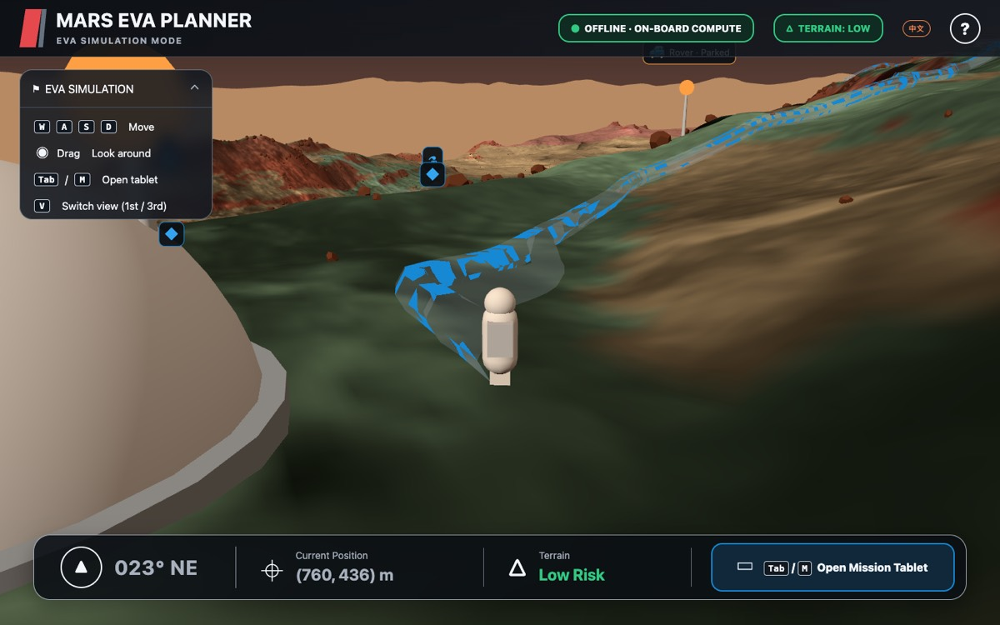
*第三人稱行走：地面是 HiRISE 真實地形，藍色帶子是規劃好的路線，菱形是無線電信標。*

### 2.3 EVA 中的平板
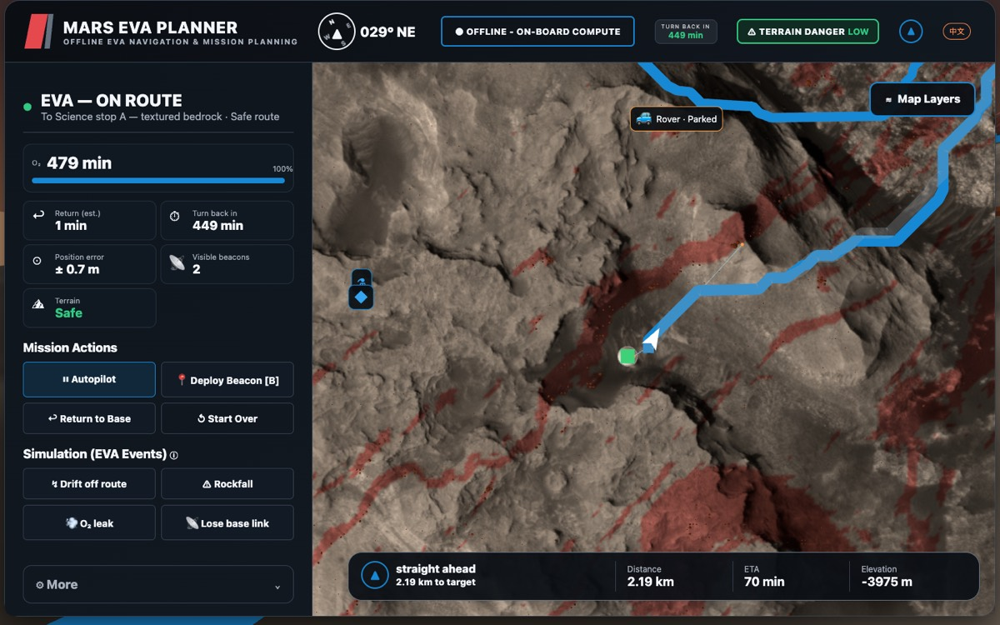
*左邊依序是氧氣剩餘、回基地時間、「還能往外走多久」（不歸點倒數）、定位誤差、可見信標數；右邊是小地圖，紅色是危險地形。*

### 2.4 緊急狀況
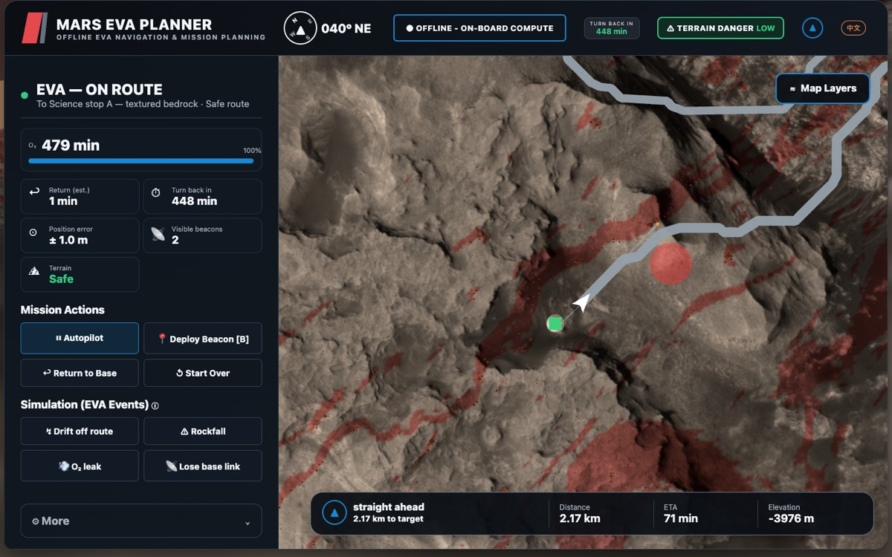
*模擬落石擋路：引擎在約 0.7 秒內算出新路線。*

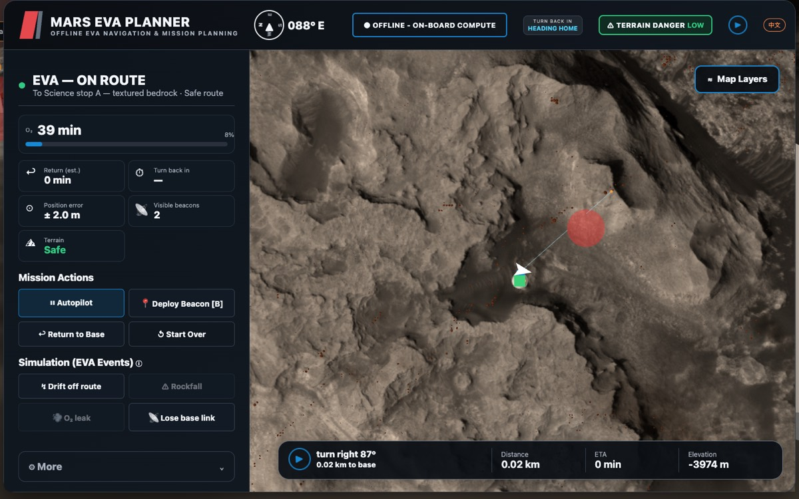
*模擬氧氣外洩：剩 40 分鐘，來回不夠，系統直接下令返回基地，倒數改成「HEADING HOME」。*

### 2.5 從整顆火星看到腳下
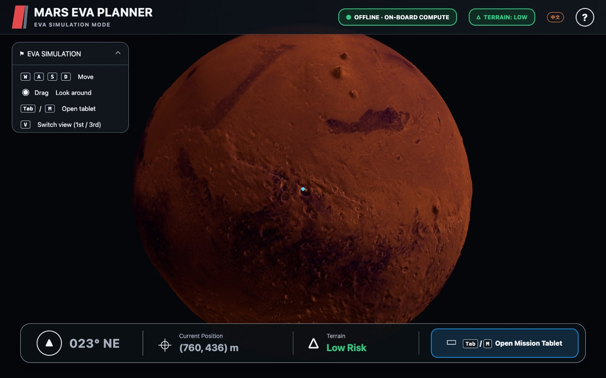
*MOLA 高程做的火星球體，藍點是我們的 EVA 地點（Gale 撞擊坑）。*

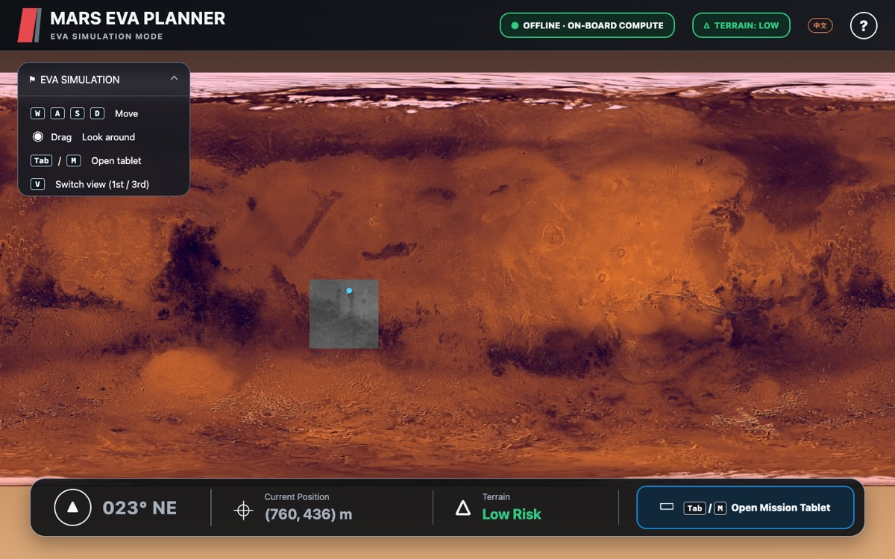
*Yi-Fan做的 2D 地圖：Viking 全球彩色底圖，灰色方塊是 MOC 的 Gale 區域影像，可以一路縮放到 HiRISE 地點。*

---

## 3. 系統怎麼組起來的

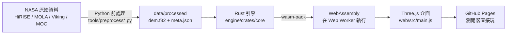

引擎的主要模組，都在 `engine/crates/core/src/`：

| 模組 | 功能 |
|---|---|
| `terrain.rs`、`edt.rs` | 坡度、粗糙度，以及「離危險地形多遠」的距離場 |
| `cost.rs` | 每一格走起來的成本（含博庭寫的 `hazard_mask`） |
| `astar.rs` | A*／Dijkstra 尋路 |
| `eva.rs` | 步行時間、氧氣消耗、輻射劑量估算 |
| `planner.rs` | 三條路線（Safe／Balanced／Science）、不歸點、重新規劃 |
| `localize.rs` | 沒有 GPS：用信標測距做多點定位，加上航位推算 |

---

## 4. 今晚的全專案檢查結果

| 項目 | 結果 |
|---|---|
| Rust 測試 | ✅ 45 個全過 |
| 瀏覽器 e2e（本機） | ✅ 規劃 → EVA → 偏離路線 → 落石 → 氧氣外洩返航，頁面無錯誤 |
| 新手導覽 e2e（中、英） | ✅ 五步走完，無錯誤 |
| 線上網址實測 | ✅ 約 3 秒載入，全流程正常 |
| 敏感資料掃描（公開前） | ✅ 沒有金鑰、密碼或 `.env` |
| SI 標記 | ⚠️ → ✅ 原本有 8 個 AI 產生的檔案沒標，**今晚已補**（見下方） |

**今晚順手修的東西**
- `tools/e2e_tablet.mjs` 和 `tools/e2e_shots.mjs`：新 UI 必須先選目的地才能規劃，舊腳本沒選，導致後面的畫面都是錯的。已修正。
- 補上 SI 標記：`docs/PLAN.md`、`web/vite.config.js`（Claude）；`tools/preprocess*.py`、`tools/validate_processed.py`、`docs/HIRISE_PREPROCESS_PLAN.md`（依 AI 使用紀錄是 Codex 協助）。
- `engDocs/SUBMISSION.md` 的「Use of SI」段落：依 AI 使用紀錄的事實起草，並註明是 AI 起草，**需要你們讀過、修改**。

---

## 5. 還需要你們決定或處理的事

1. **SI 段落請過目**：特別確認Yi-Fan那邊除了 Codex 有沒有用其他工具（例如分支名稱裡的 Antigravity），有的話要補上。
2. **`docs/DATA_CATALOG.md` 是否由 AI 產生**：紀錄裡看不出來。是的話要加標記。
3. **`docs/drive-download-…zip`**：裡面是大會給的中文說明 PDF，現在跟著 repo 公開了。建議從 repo 移除（只放在本機）。
4. **畫面上可能讓評審困惑的地方**：頂欄寫「TERRAIN DANGER LOW」，但路線風險顯示 78%。前者指腳下，後者指整條路線，可以改成「Terrain here: LOW」。
5. **Demo 影片**（Yi-Fan）：可以照著導覽的流程拍，最後放落石或氧氣外洩的畫面。
6. **送出**：建議 22:00 前在官網送出，附上 Demo 和 Repo 網址。

說明：`web/src/wasm/mars_wasm.js` 是 wasm-pack 工具自動產生的接合程式，不算 AI 產生，所以沒有加標記。
